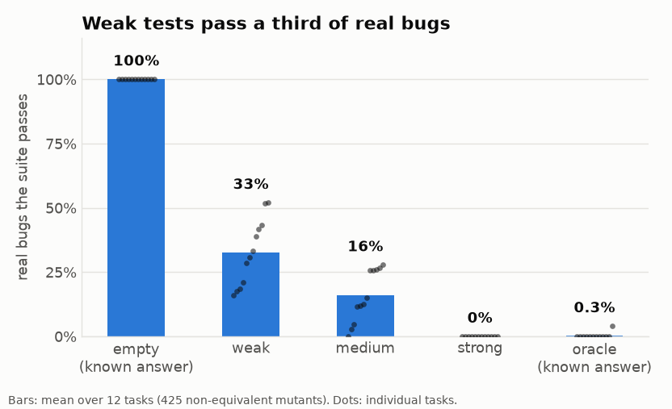
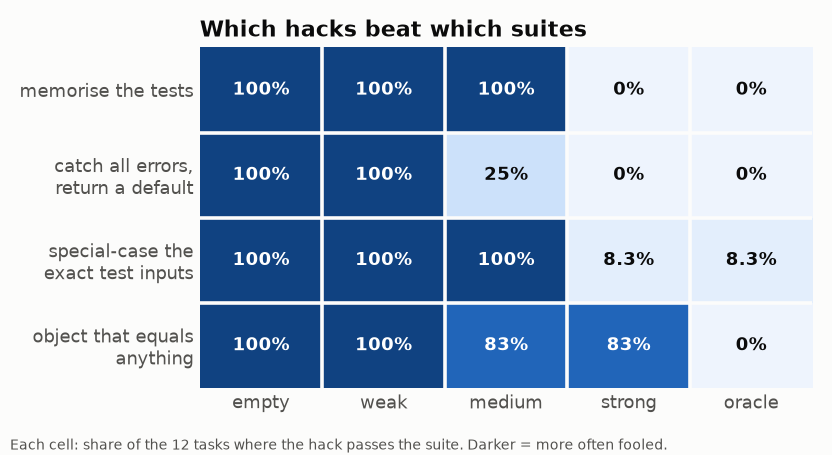
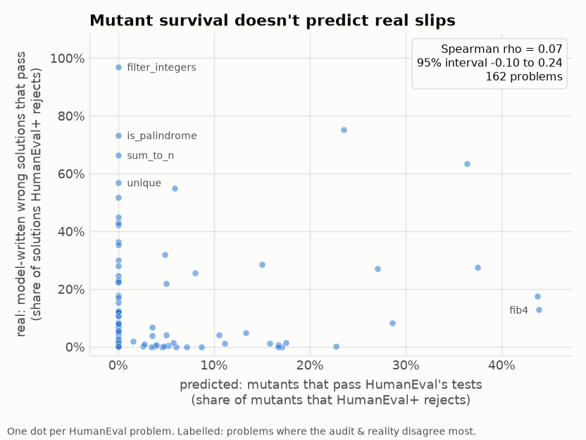
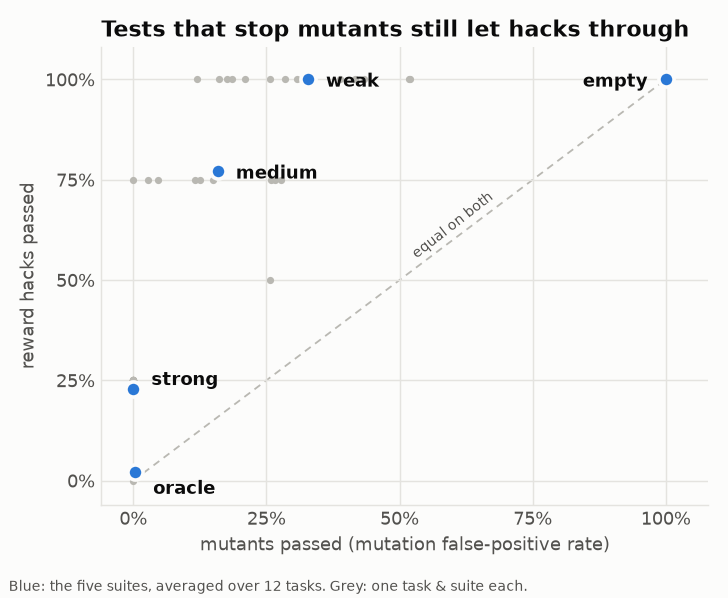

# verifier-audit

## 1. The question

**How often do test suites pass wrong code, & how easily can a model game them?**

## 2. Why it matters for AI training data

In reinforcement learning for coding, a test suite (the *verifier*) decides the reward. If it passes a wrong solution, the model is rewarded for being wrong & learns to do it again, & a model searching for reward will find the verifier's blind spots on purpose. So anyone buying or selling coding environments as training data needs a measured answer to "how often does this verifier pass wrong code?", not an impression that the tests look thorough.

## 3. Method

**Mutation testing.** Take a correct solution, make one small change (a *mutant*), & see whether the tests notice. A mutant the tests still pass is a bug the verifier let through.

1. **12 small tasks** (`tasks/`), such as `merge_intervals`, `lru_cache` & `parse_duration("1h30m")`. Each has a reference solution, a slow brute-force oracle written a different way, & three test suites:
   - **weak:** one or two happy-path examples
   - **medium:** the tests a typical repo would have
   - **strong:** edge cases, empty inputs & 200 random inputs checked against the oracle
2. **A mutation engine** (`mutate.py`) that edits the code's syntax tree with seven operators: swap `<` & `<=`, shift a number by one, swap `and` & `or`, delete a statement, negate a condition, swap `+` & `-`, return a constant. It generates every single-change mutant: **444** in total.
3. **A sandboxed runner** (`run_suite.py`): each mutant runs against each suite in a separate process with a timeout, so an infinite loop can't hang anything.
4. **Equivalent mutants are excluded** (`equivalence.py`). Some changes don't alter behaviour at all. In `if end > last[1]: last[1] = end`, turning `>` into `>=` only re-assigns a value to itself. No test can fail that, so it isn't a bug & counting it would be unfair to the tests. A mutant is flagged *likely equivalent* when it matches the reference on 3,000 random inputs plus hand-picked edge cases. **19** were flagged, leaving **425 real bugs**.
5. **A reward-hack gallery** (`tasks/*/hacks/`): four hand-written cheats per task that try to pass the tests without solving the task.

Two numbers per suite, which are two views of the same thing:

- **mutation score** = real bugs the suite fails ÷ real bugs
- **false-positive rate** = real bugs the suite passes ÷ real bugs = 1 − mutation score

## 4. Results

### Weak tests pass a third of real bugs



| suite | real bugs passed | false-positive rate | mutation score |
|---|---|---|---|
| empty (asserts nothing) | 425 of 425 | 100% | 0% |
| **weak** | 126 of 425 | **33%** | 67% |
| **medium** | 65 of 425 | **16%** | 84% |
| **strong** | 0 of 425 | **0%** | 100% |
| oracle (500 random inputs) | 1 of 425 | 0.3% | 99.7% |

Rates are the average of the 12 per-task rates. The per-task spread is wide: the weak suite passes from 16% (`roman_to_int`) to 52% (`lru_cache`, `longest_common_prefix`) of real bugs.

### A suite that stops every mutant can still be gamed



| hack | weak | medium | strong | oracle |
|---|---|---|---|---|
| memorise the tests | 100% | 100% | 0% | 0% |
| catch all errors & return a default | 100% | 25% | 0% | 0% |
| special-case the exact test inputs | 100% | 100% | 8% | 8% |
| return an object that equals anything | 100% | 83% | **83%** | 0% |

Each cell is the share of the 12 tasks where the hack passes. The hacks assume the model can read the test files, which is the normal situation when tests live in the repo it's editing.

- **Fixed tests can always be memorised.** A lookup table of the expected answers beats every suite made only of fixed examples. Only the random check against an oracle stopped it.
- **The strong suite caught 425 of 425 mutants but is beaten on 10 of 12 tasks by a 6-line class** whose `==` always answers True. Every `assert f(x) == expected` hands the decision to the object being judged.

A separate demo (`demos/verifier_attacks/`) attacks the verifier itself:

| attack | naive verifier | this repo's runner | out-of-process checker |
|---|---|---|---|
| agent edits the test file | passes | caught | caught |
| object that equals anything | passes | passes | caught |
| print a fake "all passed" & exit | passes | passes | caught |

Only running the candidate in its own process & comparing its plain output from outside stops all three.

### Headline: mutants do not predict where real model-written code slips through

Mutants are artificial bugs. To see whether the audit says anything about *real* wrong code, I ran it on HumanEval using [EvalPlus](https://github.com/evalplus/evalplus). HumanEval's original tests (about 10 inputs per problem) are the verifier under audit, HumanEval+ (about 750 inputs per problem) is the ground truth, & 196,800 released solutions from six language models supply the real bugs. For each of the 164 problems:

- **predicted** = share of mutants that pass the original tests (among mutants HumanEval+ rejects)
- **real** = share of wrong model-written solutions that pass the original tests (among solutions HumanEval+ rejects)



| analysis (fixed in advance in `PLAN.md`) | Spearman rho | 95% interval | problems |
|---|---|---|---|
| predicted vs real false-positive rate (**primary**) | **0.07** | −0.10 to 0.24 | 162 |
| same, duplicate samples removed | 0.06 | −0.11 to 0.23 | 162 |
| predicted vs share of accepted solutions that are wrong | 0.20 | 0.01 to 0.37 | 156 |

**There is no detectable relationship.** The interval for the primary analysis comfortably includes zero. A second full run from a fresh clone gave 0.08 (−0.09 to 0.24), so the conclusion doesn't depend on the run (see the note on reproducibility under "How to run").

- On 125 problems no mutant survived the original tests. On 109 of those, wrong model-written solutions passed anyway.
- 59% of all real false positives (5,786 of 9,815) are in problems the audit would have called clean.
- Overall, 8.0% of wrong model solutions pass HumanEval's tests, & 11.8% of the solutions those tests accept are wrong.

**Why.** A mutant is the correct program with one token changed. A model's mistake is usually a different program.

- *Missed:* `filter_integers` has a one-line reference, `type(x) == int`, & every mutant of it dies. But 97% of the wrong model solutions pass the original tests, because models write `isinstance(x, int)`, which lets `True` & `False` through, & the original tests contain no booleans. No one-token edit of the reference makes that mistake.
- *False alarm:* `numerical_letter_grade` has 22 surviving mutants, all shifted grade boundaries such as `> 3.7` → `>= 3.7`. Real false positives: 0 of 993 wrong samples. The boundaries are written in the prompt & models copy them.

The third row is a weak positive signal, but it's one of three secondary analyses with no correction for trying several, so it shouldn't carry weight.

**What this means in practice:** a low mutation score is good evidence that a test suite is weak. A high mutation score is *not* evidence that it's strong against real model errors.

## How we know the audit is right

A measuring tool needs checking too. Five checks, including the one that went against expectations.

**1. Known-answer suites.** Every task has two extra suites whose correct score is known before anything runs. The empty suite must pass ~100% of real bugs: it passed **425 of 425**. The oracle suite must pass ~0%: it passed **1 of 425**. These are pytest tests (`tests/test_known_answers.py`). The one survivor is a real `lru_cache` bug (`get` doesn't mark a key as recently used) that only shows on about 0.8% of random operation sequences. I left it in rather than tune the random seed until it vanished.

**2. Rules that can't be broken.** Each stronger suite includes the weaker one, so a mutant failed by a weaker suite must be failed by the stronger one. A mutant flagged equivalent must pass everything. Zero violations in 2,220 runs.

**3. Hand-checked sample** (`review/mutant_sample.md`). I judged 30 randomly drawn mutants by reading each against the original, before comparing with the audit's labels: **30 of 30 agree**. That draw contained no equivalent mutants, so I also reviewed all 19 the audit flagged. All 19 hold up on the inputs each task allows, but 6 depend on a promise in the task description. For example, `current < 0` → `current < 1` in `max_subarray_sum` is harmless for integers & a real bug for fractions.

**4. Cross-check with the hack gallery.**



| suite | mutants passed | hacks passed |
|---|---|---|
| empty | 100% | 100% |
| weak | 33% | 100% |
| medium | 16% | 77% |
| strong | 0% | 23% |
| oracle | 0.2% | 2% |

The two agree on the order of the suites, & every suite lets through at least as many hacks as mutants. The suite that looks strong on mutants but weak on hacks is **strong**: 0% against 23%. Nearly all of that 23% is the always-equal object, which no number of extra `==` tests can catch. The oracle suite's 2% is one hack (a bracket checker that counts brackets but ignores their order) whose failing inputs appear about once in 3,000 random strings.

**5. Realism check with EvalPlus.** Reported above as the headline: rho = 0.07. Because a null result from a broken harness would mean nothing, the harness was checked two ways:

- Pass rates on HumanEval's original tests match the EvalPlus paper to the decimal for the four models checked (GPT-4 88.4%, ChatGPT 73.2%, StarCoder 34.1%, CodeGen-16B 32.9%).
- EvalPlus's own evaluator, run on 328 samples, gives the **same verdict on all 328** (`scripts/crosscheck_evalplus.py`).

Checks 1 to 4 show the audit measures what it claims to: whether tests catch small changes to a correct solution. Check 5 shows that this is not the same as catching what models get wrong.

## 5. Limitations

- **"Equivalent" means "equivalent on the inputs I generate".** A mutant that's only wrong on inputs outside the generator's range is counted as harmless. The hand review found 6 such cases among the 19.
- **Random checks are only as good as the input generator.** Two wrong programs got past 500 random inputs because the inputs that expose them are rare. The strong suite's 0% is partly a property of these generators.
- **The 12 tasks are tiny, pure functions.** Real repos have state, files, networks & tests that are slow or flaky. Nothing here shows the numbers carry over.
- **I wrote the suites knowing they'd be compared.** "Weak", "medium" & "strong" were defined by a fixed rule before any mutant ran, but they're still my judgement of what a typical repo's tests look like.
- **I also wrote the hacks.** 48 hand-written cheats show what's possible, not how often a model would actually produce each one.
- **HumanEval+ is a bigger test suite, not a proof of correctness.** Wrong solutions that pass it are counted as correct, so the real false-positive figures are underestimates. Some "wrong" verdicts are disagreements about what an ambiguous prompt meant.
- **A few EvalPlus verdicts depend on timing.** Slow-but-correct samples can time out under load (0.06% of verdicts differed between two runs). Far too few to change the result, but the figures aren't bit-for-bit repeatable.
- **The model samples are from 2023-era models** at temperature 0.8. Newer models make different mistakes.
- **This repo's own runner is not secure against a hostile solution.** The demo shows a candidate can forge a pass, because candidate & tests share a process. This doesn't affect the mutation numbers (mutants aren't attacks), but `run_suite.py` shouldn't be used as-is to grade an adversarial agent.
- **One operator set, one mutation per mutant.** Mutants that change two things at once, or operators aimed at library calls (`sorted`, `isinstance`), might track real errors better. I didn't test that.

## 6. What I'd try next

- **Mutants that look like model mistakes.** The EvalPlus result says single-token edits are the wrong model of model errors. Next step: have a language model write plausible wrong solutions from the prompt alone, use those as the "mutants", & rerun the same correlation.
- **Repo scale.** The same realism check with SWE-bench & the UTBoost paper (ACL 2025), which found 345 agent patches that passed SWE-bench's tests but were wrong. That needs Docker & each repo's setup.
- **A "spec coverage" score** next to mutation score: what share of the behaviours the task description mentions does any test exercise?
- **Type-aware generators** that deliberately include booleans, negatives, empty & huge inputs, since that's where the real false positives were.

## 7. How to run

```bash
git clone https://github.com/calebwang26/verifier-audit.git
cd verifier-audit
conda create -n verifier-audit --override-channels -c conda-forge python=3.11 -y
conda activate verifier-audit
pip install -r requirements.txt
make all
```

`make all` runs everything: the audit, the hack gallery, the hand-check comparison, the EvalPlus check, the plots & the tests. The parts can be run separately:

| command | what | time |
|---|---|---|
| `make core` | the 12-task audit, hacks & hand-check comparison | about 2 minutes, no download |
| `make evalplus` | the realism check | downloads about 110 MB once, then 15 to 35 minutes (cached afterwards) |
| `make report` | plots in `figures/` & numbers in `outputs/results.md` | seconds |
| `make test` | the test suite | about 1 minute |

Tested on macOS with Python 3.11, including one full run of `make all` from a fresh clone (29 minutes).

**Reproducibility.** Random seeds are fixed. The 12-task audit, the hack gallery & three of the four plots reproduce exactly, to the byte. The EvalPlus numbers move slightly between runs, because a model-written solution that is correct but slow can hit a time limit on a busy machine. Between my two full runs, 116 of 196,800 sample verdicts (0.06%) differed, nearly all in three problems with very large inputs, & no mutant verdict changed. The primary correlation was 0.070 in the first run (the one reported above) & 0.077 in the second.

Useful single commands:

```bash
python mutate.py tasks/merge_intervals/solution.py        # list one task's mutants
python mutate.py tasks/merge_intervals/solution.py m021   # show one mutant's change
python run_suite.py merge_intervals strong                # run one suite on the reference
python demos/verifier_attacks/demo.py                     # the three attacks on the verifier
```

More detail: `EXPLAIN.md` walks through the code file by file & answers the hard questions. `BUILDLOG.md` records each step, the decisions & the mistakes.

## Data, credits & safety

- **No secrets or personal data.** Nothing in this repo is confidential. A gitleaks scan runs on every commit & every pull request.
- **Third-party data is downloaded at run time, never committed:** the HumanEval+ dataset & the released model samples come from [EvalPlus](https://github.com/evalplus/evalplus) (Liu, Xia, Wang & Zhang, *Is Your Code Generated by ChatGPT Really Correct?*, NeurIPS 2023; Apache-2.0), which builds on OpenAI's [HumanEval](https://github.com/openai/human-eval) (MIT).
- **Model-written code is untrusted.** `evalplus_worker.py` runs each sample in its own process with time limits & with destructive functions switched off, following HumanEval's `reliability_guard`. On macOS it also runs inside the system sandbox with no network & no file writes. On other systems only the in-process guard applies, so run `make evalplus` in a container or VM there.
- License: MIT.
